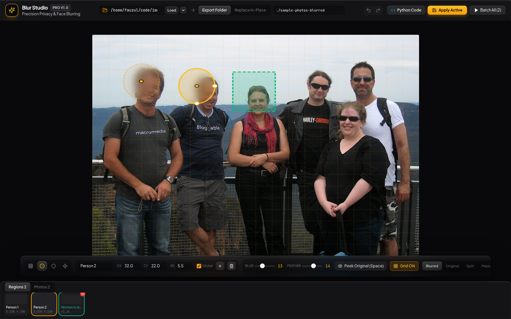

# Blur Studio

Coordinate-based selective photo blurring — precisely blur faces, plates, screens, or any region while keeping VIP subjects sharp, from a glass-UI web app, a CLI, or an MCP server that AI agents can drive directly.

[](https://github.com/fauzulkc/blur-studio/actions/workflows/ci.yml)
[](https://github.com/fauzulkc/blur-studio/blob/main/LICENSE)
[](https://nodejs.org)



## What it is

Blur Studio applies Gaussian blur with soft feathered edges to exact regions of an image — ellipses, rectangles, or hand-painted grid tiles — and can carve out rectangular "VIP" exclusion boxes that stay 100% sharp even when they overlap a blurred region. The same processing engine (`blurService.js` → `blur_processor.py`) is exposed three ways:

- **Web UI** — a glass-materials dark studio for humans to click, drag, and paint regions on real photos.
- **CLI** (`blur-studio`) — scriptable access to every operation for shell pipelines and automation.
- **MCP server** — the same tools exposed over stdio so an AI agent (with its own vision) can decide what to blur and call it directly.

## Features

- **Four contextual tools** — grid paint, ellipse, VIP box, and pan — switchable by click or keys `1`–`4`
- **Ellipse targets** — draggable, resizable center+radius regions with optional per-target blur/feather override
- **VIP exclusion boxes** — rectangular "stay sharp" zones that punch through any overlapping blur
- **Grid painting** — paint a density-adjustable grid of tiles over an image, then convert painted tiles into ellipse targets in one click
- **Per-target blur override** — one region can use a heavier or lighter blur/feather radius than the image-wide default
- **Undo/redo** — full document history (targets, exclusions, grid paint) across all loaded images, via buttons or `Ctrl+Z` / `Ctrl+Shift+Z`
- **Four view modes** — Blurred, Original, Split (side-by-side), and Mask (see exactly what the blur mask covers), plus a hold-`Space` peek-original
- **Batch processing** — apply saved regions across an entire folder in one pass, with a live per-image progress list
- **Single & bulk download** — download the just-processed photo, or zip every batch output for one-click download
- **Destination modes** — write to a separate output folder (default, non-destructive) or replace files in place with an automatic `.bak` backup
- **Python export** — turn the current saved config into a standalone Python snippet (`EXCLUSION_BOXES` / `EXPLICIT_BLUR_TARGETS`) for another pipeline
- **CLI + MCP parity** — every capability of the web UI is also a CLI command and an MCP tool, backed by the same `blurService.js`

## Quick Start

Requires Node.js >=20 and Python 3.10+ with [Pillow](https://pypi.org/project/Pillow/).

```bash
git clone https://github.com/fauzulkc/blur-studio.git
cd blur-studio
npm install
pip install -r requirements.txt

./start.sh
```

`start.sh` installs npm dependencies on first run, starts the backend, then the frontend dev server. Or run the two halves yourself:

```bash
npm run server   # backend API — http://localhost:3333
npm run dev      # frontend — http://localhost:5173
```

Open **http://localhost:5173**. The app loads the bundled `sample-photos/` folder by default, so there's something to click on immediately.

## How it works

Blur Studio does **not** do automatic face, license-plate, or subject detection. It has no model for "what a face looks like." Every blur region is a set of exact normalized `0–1` coordinates that the caller supplies:

- an **ellipse** — `{ cx, cy, rx, ry }`, a center point + radii
- a **rectangle / grid tile** — `{ x1, y1, x2, y2 }`, top-left and bottom-right corners
- an **exclusion box** — `{ x1, y1, x2, y2 }`, same shape, but it keeps that region sharp instead

`(0, 0)` is the top-left corner of the image, `(1, 1)` is the bottom-right — so coordinates stay correct regardless of the image's actual pixel dimensions.

This is a deliberate design constraint, not a missing feature:

- A **human** using the web UI supplies coordinates by clicking, dragging, and painting.
- An **agent** using the CLI or MCP server supplies coordinates by looking at the image with its own vision and deciding what needs to be blurred.

`blurService.js` is the single source of truth for this contract — it validates and forwards the same shapes to `blur_processor.py` (Pillow) regardless of which of the three front ends called it.

## Web UI

```bash
npm run server   # terminal 1 — backend, port 3333 (override with PORT env var)
npm run dev      # terminal 2 — frontend, port 5173
```

1. Point the source-folder field at a directory of images (or pick a Quick Preset).
2. Select a tool (`1` grid, `2` ellipse, `3` VIP box, `4` pan) and mark regions on the active photo.
3. Adjust blur/feather radius, and per-target overrides if needed.
4. Choose a destination mode — **Export Folder** (safe default) or **Replace In-Place**.
5. **Apply Active** to process the current photo, or **Batch All** to process every photo in the folder — then **Download**.

## CLI

The `blur-studio` command wraps `blurService.js` for humans and scripts (`node cli.js <command>` also works without installing globally).

```bash
node cli.js --help
```

```
Commands:
  presets                  List quick-access image folder presets
  scan [options]           Scan a folder for images along with their configured targets/exclusions
  config                   Print the full persisted app configuration
  save-config [options]    Save per-image targets/exclusions and/or global blur settings
  apply [options]          Apply blur processing to a single image, or a batch of items
  export-python [options]  Export the current config as a Python snippet
```

Every flag that takes JSON (`--targets`, `--exclusions`, `--items`) also accepts an `@file.json` path, so large coordinate arrays never have to survive shell quoting.

**Scan a folder** for images and their currently saved regions:

```bash
node cli.js scan --folder ./sample-photos
```

**Blur one image** — an ellipse over one region, a rectangle kept sharp:

```bash
node cli.js apply \
  --input ./sample-photos/sample-1.jpg \
  --output ./sample-photos-blurred/sample-1.jpg \
  --targets '[{"cx":0.15,"cy":0.2,"rx":0.055,"ry":0.075,"label":"Person 1"}]' \
  --exclusions '[{"x1":0.43,"y1":0.16,"x2":0.56,"y2":0.33,"label":"VIP - keep sharp"}]' \
  --blur-radius 13 --feather-radius 14 \
  --destination-mode separate_folder
```

**Batch-process several images** from a JSON file of `{inputPath, outputPath, targets, exclusions}` items:

```bash
node cli.js apply --items @batch.json --destination-mode separate_folder
```

Run `node cli.js <command> --help` for the full flag list of any subcommand.

## MCP server

`mcp-server.js` exposes the same operations as MCP tools over stdio (`StdioServerTransport`), so an agent can drive the app directly — deciding what to blur with its own vision, then calling the tool with exact coordinates.

| Tool | Description |
|---|---|
| `list_presets` | List the quick-access image folder presets |
| `scan_folder` | Scan a folder for images plus each one's saved targets/exclusions and global defaults |
| `get_config` | Return the full persisted config (targets, exclusions, folders, blur defaults) |
| `save_image_config` | Persist targets/exclusions for a filename and/or update global blur defaults — writes config only, no pixels |
| `apply_blur` | Actually blur pixels for one or more images and write output — the tool that does the work |
| `export_python_snippet` | Render the persisted config as a standalone Python snippet |

`apply_blur`'s tool description spells out the same no-auto-detection contract as above — the agent must supply exact `{cx,cy,rx,ry}` or `{x1,y1,x2,y2}` coordinates itself.

### Registering it (add to your MCP client)

Every MCP client wants the same basic shape — a `command` to spawn plus its `args` — just in a different config location. Point it at this repo's `mcp-server.js` directly, or at the `mcp` Docker image (see [Docker](#docker)) if you'd rather not install Node/Python locally.

**Claude Code** — if you clone *this repo* and open Claude Code inside it, the checked-in `.mcp.json` is auto-detected and Claude Code will prompt to enable it — nothing else to do. To make it available from *any* directory instead:

```bash
claude mcp add --scope user blur-studio -- node /absolute/path/to/blur-studio/mcp-server.js
# or, via Docker, no local Node/Python required:
claude mcp add --scope user blur-studio -- docker run -i --rm -v ~/Photos:/photos blur-studio-mcp
```

**Claude Desktop** — add an entry to its config file (create the file if it doesn't exist yet):

| OS | Path |
|---|---|
| macOS | `~/Library/Application Support/Claude/claude_desktop_config.json` |
| Windows | `%APPDATA%\Claude\claude_desktop_config.json` |
| Linux | `~/.config/Claude/claude_desktop_config.json` |

```json
{
  "mcpServers": {
    "blur-studio": {
      "command": "node",
      "args": ["/absolute/path/to/blur-studio/mcp-server.js"]
    }
  }
}
```

**Cursor** — same JSON shape, in `.cursor/mcp.json` (project-scoped) or `~/.cursor/mcp.json` (every project).

**Any other MCP-capable tool** — register the same `command`/`args` pair however that tool takes MCP server configuration; this repo's own `.mcp.json` is a working reference for the exact shape.

## Using the skill (Claude Code) / AGENTS.md (everyone else)

This repo ships two parallel sets of agent-facing instructions — install neither, both travel with the repo automatically:

- **`.claude/skills/blur-studio/`** — a Claude Code Skill. It's **project-scoped**: clone this repo, open Claude Code with it as your working directory, and Claude Code auto-discovers and can invoke it — no separate install step. To make it available in *every* project instead of just this one, copy or symlink it into your personal skills folder:
  ```bash
  ln -s "$(pwd)/.claude/skills/blur-studio" ~/.claude/skills/blur-studio
  ```
- **`AGENTS.md`** (repo root) — the same operating instructions in a plain, tool-agnostic file for any other agent that reads repo context automatically (Cursor, OpenAI Codex CLI, Gemini CLI/Antigravity, etc.). Nothing to install — it's just read from the working directory like this README.

## Docker

One multi-target `Dockerfile` builds two independent images, sharing a common Node + Python/Pillow/numpy base:

| Target | Build | What it runs | Port |
|---|---|---|---|
| `web` | `docker build --target web -t blur-studio-web .` | `server.js` — the Express API **and** the built React UI, on one HTTP port. **This is the image to deploy for hosting the app.** | `3333` |
| `mcp` | `docker build --target mcp -t blur-studio-mcp .` | `mcp-server.js` over stdio — no port, no UI, spawned directly by an MCP client. | — |

`docker build .` with no `--target` builds `web`.

**Deploy the full app:**

```bash
docker build --target web -t blur-studio-web .
docker run -d -p 3333:3333 -v ~/Photos:/photos blur-studio-web
```

Open **http://localhost:3333** — the API and UI are served from the same container. A `HEALTHCHECK` hits `/health` every 30s so orchestrators (Docker, Kubernetes, most hosting platforms) can tell it's actually serving requests, not just running.

**Run the MCP server in a container:**

```bash
docker build --target mcp -t blur-studio-mcp .
docker run -i --rm -v ~/Photos:/photos blur-studio-mcp
```

**Only the folders you explicitly mount (`-v host:container`) are visible inside either container.** The rest of your filesystem is not reachable — pass whichever photo directories you need as bind mounts, and reference the container-side path (e.g. `/photos`) in the UI's source-folder field or when calling `scan_folder`/`apply_blur`.

`docker-compose.yml` runs both as named services (`web` and `mcp`), each with its own persistent volume for `blur_studio_config.json` so saved regions survive container restarts:

```bash
docker compose up -d web          # full app at http://localhost:3333
docker compose run --rm -i mcp    # MCP server, stdio-attached
```

Edit the commented-out volume line under whichever service you use to point at your own photo folder before running it — see the file's own comments for the full picture, including the `destinationMode: 'replace'` in-place-overwrite caveat.

This image has no authentication of its own — see [SECURITY.md](SECURITY.md) before exposing the `web` container to anything beyond your own machine/network.

## Safety & privacy

> **`destinationMode` controls whether your original files are touched.**
>
> - **`separate_folder`** (default, safe) — originals are never modified; blurred output is written to a separate destination folder.
> - **`replace`** — overwrites the source file **in place**. The original is backed up first to `<file>.bak` unless backups are explicitly disabled (`--no-backup` on the CLI, or `makeBackup: false` via the API/MCP). Use this mode deliberately, and be especially careful when mounting a real photo folder into the Docker container with `replace` mode — you are giving the container permission to overwrite files in that mount.

## Testing

```bash
npm run test:e2e
```

This drives the real running app in headless Chromium (Playwright) — not mocked. It requires both servers running first:

```bash
node server.js &          # backend, port 3333
npx vite --port 5173 &    # frontend
npm run test:e2e          # defaults to http://localhost:5178; override with BLUR_STUDIO_URL
BLUR_STUDIO_URL=http://localhost:5173 npm run test:e2e
```

It covers every interactive function — image browsing/search/filter, all four tools, ellipse and VIP-box create/select/edit/delete, grid density/paint/convert/clear, blur/feather sliders, all four view modes, peek-original, zoom/pan, undo/redo, destination-mode toggle, the Python/Batch modals — and, for real rather than as a presence check, **Apply Active**, **Start Batch Processing**, and both **Download** buttons.

These real Apply/Batch runs are safe because the app's default folder is the bundled `sample-photos/` — two CC0 (public-domain) photos checked into the repo (see `sample-photos/CREDITS.md`). Output only ever lands in the gitignored `sample-photos-blurred/` folder; the tracked source images are never mutated in place. See `tests/e2e/README.md` for the full testing conventions.

## Architecture

Three front ends — the Web UI (via `server.js`'s Express API), the CLI (`cli.js`), and the MCP server (`mcp-server.js`) — all call into the same `blurService.js`, which shells out to `blur_processor.py` (Pillow) to actually touch pixels. No front end talks to Python directly.

```
        Web UI (React)        CLI (blur-studio)       MCP server (agents)
             │                        │                        │
             ▼                        ▼                        ▼
        server.js  ─────────────────────────────────────────────
        (Express API)          blurService.js
                                      │
                                      ▼
                              blur_processor.py
                                (Pillow, subprocess)
                                      │
                                      ▼
                                 image files
```

## Contributing

See [CONTRIBUTING.md](CONTRIBUTING.md) for how to get set up and submit changes.

## License

[MIT](LICENSE) © Fauzul Chowdhury

## Security

See [SECURITY.md](SECURITY.md) for how to report a vulnerability.
